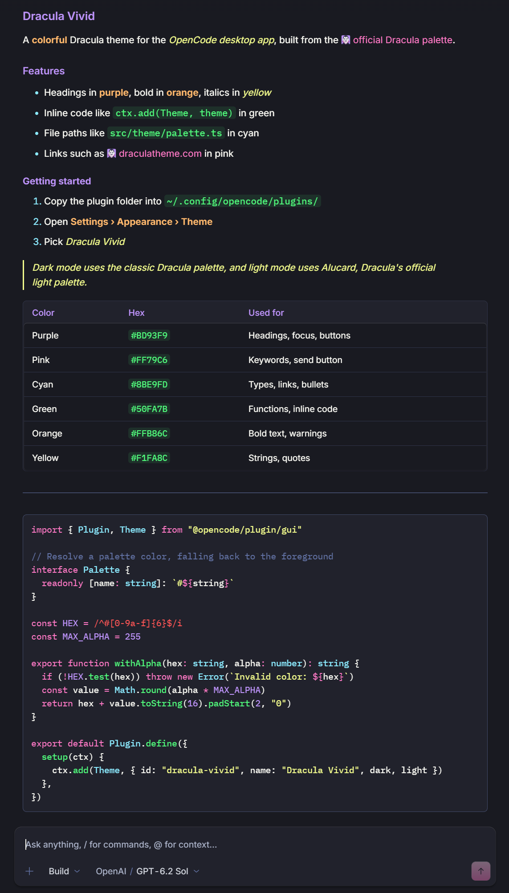

# Dracula Vivid

A colorful [Dracula](https://draculatheme.com) theme for the [OpenCode](https://opencode.ai) desktop app.

The desktop app's built-in Dracula theme leaves most of the interface gray. Dracula Vivid uses the [official palette](https://draculatheme.com/spec) across the whole app, and colors chat markdown the way the Dracula spec does.



## Features

- Purple and pink buttons, purple focus rings and hover tints
- Chat markdown per the Dracula spec: purple headings, orange bold, yellow italics and quotes, green inline code, pink links and cyan list bullets
- Code highlighting per the Dracula spec
- Green, orange, red and cyan for success, warning, error and info, and a different Dracula color for each agent
- Light mode uses Alucard, Dracula's official light palette

## Install

Clone this repository into OpenCode's global plugins folder on the machine that runs the desktop app:

```sh
# macOS and Linux
git clone https://github.com/AaronFeledy/opencode-dracula-vivid ~/.config/opencode/plugins/dracula-vivid
```

```powershell
# Windows
git clone https://github.com/AaronFeledy/opencode-dracula-vivid "$env:USERPROFILE\.config\opencode\plugins\dracula-vivid"
```

Then open **Settings › Appearance › Theme** and pick **Dracula Vivid**.

## Customize

All colors are defined in [`gui-experimental.cjs`](gui-experimental.cjs). There's no build step. Save the file and the app picks up the change within a few seconds.

Dark mode uses Dracula's darker official background shades, with one extra shade (`#111217`) for the sidebar.

## Notes

The theme relies on OpenCode's GUI plugin API, which is experimental and may change between releases.

## License

[MIT](LICENSE)
